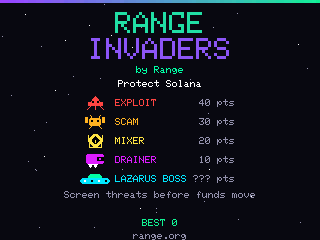
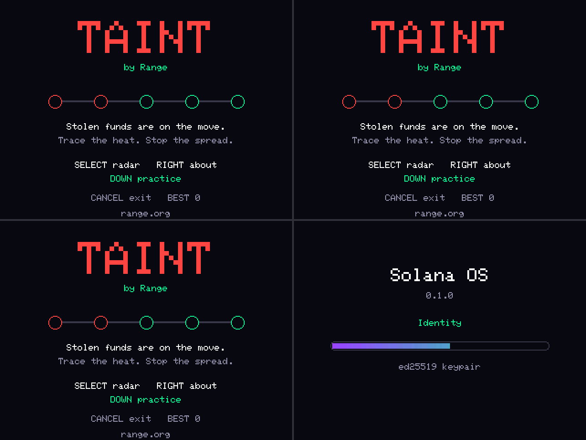

# Range Invaders and Taint

Two Lua games for the Solana Breakpoint "Scale or Die" badge: ESP32-S3, a
320x240 display, D-pad, SELECT and CANCEL, two LEDs and ESP-NOW radio.

**Range Invaders** is an offline arcade shooter. Screen out EXPLOIT, SCAM,
MIXER and DRAINER threats. Targets are named Solana threats, combining real
incidents with generic threat types. Kill popups show the target's name and
points; RANGE ALERT shows the name of the threat that got through. Scan its
QR to learn about
[Range transaction screening](https://www.range.org/product/transaction-screening).

**Taint** is a nearby-badge game about stolen funds moving wallet to wallet.
Start an outbreak, watch your HEAT, screen nearby badges and quarantine the
taint before the round ends. Tainted players also score for spreading it,
shown as LAUNDERING. Solo practice uses five simulated wallets without radio
traffic or changes to your saved best score.

## Install

1. On a badge running Solana OS, enable **Settings > App store**, connect it
   to the store's broker and copy its badge ID.
2. Open the badge SDK web app's `/store` page. Enter the badge ID and this
   repository URL: `https://github.com/Jars1987/RangeDefenders`.
3. Select **range-defenders** (Range Invaders) and **range-taint** (Taint), send
   the offer, then accept it with SELECT on the badge while in the launcher.

The store installs only each app folder's `main.lua`, with a 96 KB limit.
Both games are self-contained; they need no extra modules or images.
Install from the branch containing the finished games if it has not reached
the repository's default branch yet.

For the browser simulator, run the badge SDK web app locally (`bun install`,
then `bun run dev` in its `app/` directory) and its private broker (`bun install`,
then `bun run dev` in `broker/`). Open `http://localhost:5173/badge`, set the
broker to `http://localhost:8787`, leave networking on, and apply/reboot.
Use the virtual badge's ID on `http://localhost:5173/store`, with the same
broker and repository URL. Accept the offer in the virtual badge's launcher.
The on-screen D-pad, SELECT and CANCEL reproduce the hardware controls.
Separate simulator badges need separate browser profiles/storage and the same broker.

## Controls

| Screen | Control | Action |
| --- | --- | --- |
| Invaders title | SELECT / RIGHT / CANCEL | Start / About / Exit |
| Invaders play | LEFT, RIGHT | Move |
| Invaders play | Hold SELECT or UP | Fire |
| Invaders play | CANCEL | Pause |
| Invaders pause | SELECT / CANCEL | Resume / Menu |
| RANGE ALERT | SELECT / DOWN / RIGHT / CANCEL | Retry / QR / About / Menu |
| Taint title | SELECT / RIGHT / DOWN / CANCEL | Radar / About / Practice / Exit |
| Taint idle radar | Hold SELECT for 2 seconds | Start outbreak |
| Taint radar or practice | UP, DOWN / SELECT | Select peer / Screen |
| Taint radar or practice | CANCEL | Title |
| Taint end | SELECT / DOWN | Title / QR |
| About | DOWN | QR |
| QR | CANCEL or UP | Return to the screen that opened it |

Practice is available when this badge is not in an active round. Screening
uses one credit; credits recover over time. Badges must be close enough to
screen. A round lasts up to 180 seconds, with a 20-second latent period for
the source; 15 seconds with no fresh taint observation ends it CONTAINED.

ESP-NOW is **unencrypted**. Taint is a game, **not a security control**.
Badges need the same radio channel; joining different Wi-Fi access points can
put them on different channels. Leave Wi-Fi off for badge-to-badge play and
agree a channel. Practice works alone.

## Regenerate the QR codes

Use a virtual environment and install segno. The encoder chooses the QR version
in byte mode with error correction L. These URLs produce 45x45 module matrices.
The badge draws 4px modules with a four-module white quiet zone.

```sh
python3 -m venv /tmp/range-qr-venv
/tmp/range-qr-venv/bin/pip install segno
/tmp/range-qr-venv/bin/python tools/make_qr.py \
  --url 'https://www.range.org/product/transaction-screening?utm_source=event-breakpoint&utm_medium=qr&utm_campaign=always-on&utm_content=badge-invaders' \
  --write scripts/range-defenders/main.lua
/tmp/range-qr-venv/bin/python tools/make_qr.py \
  --url 'https://www.range.org/product/transaction-screening?utm_source=event-breakpoint&utm_medium=qr&utm_campaign=always-on&utm_content=badge-taint' \
  --write scripts/range-taint/main.lua
/tmp/range-qr-venv/bin/python tools/make_qr.py --check scripts/range-defenders/main.lua
/tmp/range-qr-venv/bin/python tools/make_qr.py --check scripts/range-taint/main.lua
/tmp/range-qr-venv/bin/python tools/make_qr.py --pgm /tmp/invaders-qr.pgm scripts/range-defenders/main.lua
zbarimg --quiet --raw /tmp/invaders-qr.pgm
```

Writes are idempotent; checks are read-only. `--check` can also take `--url` to
verify the intended URL as well as its encoding. PGM export uses the matrix
stored in Lua and does not require segno.

## Headless tests

Use Lua 5.4, for example Homebrew `lua@5.4`; Lua 5.5 is not the badge runtime.
The commands below use Homebrew's Apple Silicon installation path:

```sh
python3 -m py_compile tools/*.py
/tmp/range-qr-venv/bin/python tools/test_tools.py
/opt/homebrew/opt/lua@5.4/bin/lua tools/harness.lua --self-test
/opt/homebrew/opt/lua@5.4/bin/lua tools/harness.lua all
/opt/homebrew/opt/lua@5.4/bin/lua tools/harness.lua all --final
/opt/homebrew/opt/lua@5.4/bin/lua tools/harness.lua invaders_play --dump-qr /tmp/invaders-screen.pgm
zbarimg --quiet --raw /tmp/invaders-screen.pgm
```

Each scenario prints one PASS/FAIL line with its maximum callback CPU time;
any failure exits non-zero. Available scenarios:

- `invaders_play`, `invaders_killer`, `invaders_breach`, `invaders_pause`, `invaders_names`.
- `taint_2`, `taint_arbitration`, `taint_protocol`, `taint_4_lossy`, `taint_20`.
- `taint_practice_timeout`, `taint_practice_win`, `taint_restart`.
- `taint_end_screen`, `taint_p_flood`.

Invaders tests run the game source directly with its fixed roster of named
threats. A bot uses normal controls, with a read-only geometry adapter for
the original game's closure names (`px`, `fx`, `fy`, `aliens`, `ebullets`).
Assertions use the public `__state()` hook and captured text. The killer
scenario searches fixed seeds for a shot whose shooter is killed before that
same bullet causes the fatal hit, then checks the shooter's name on RANGE
ALERT. The names scenario checks row pools, variety, the LAZARUS boss, text
through a full game and popup bounds at both screen edges. `--final` rejects
remaining placeholder source or text.
`--invaders FILE` and `--taint FILE` select parallel worktree builds for testing.

The stub creates a separate Lua environment, RNG, key state and in-memory kv
store per badge. At 60Hz it delivers radio, button edges, update, then draw.
Its ESP-NOW bus has distinct MACs, fixed RSSI links, a seven-message inbound
cap per badge/frame, counted drops, seeded loss/duplication/reordering, raw
injection and disconnect/rejoin support. The framebuffer composes geometry
and exports a 320x240 PGM; text calls are captured exactly, while glyph pixels
are represented by approximate masks. QR pixels and quiet zones are exact.
The self-test uses tiny fixture apps to check the harness itself; it does not
replace `all` against the finished games.

Every numeric argument crossing a `badge.*` boundary is checked: integers
must fit int32; floats must be finite; gfx geometry, sizes and colours must
be integral int32 values. The host interpreter is 64-bit. This does **not**
emulate int32 overflow or float32 arithmetic inside either game. Physical
badge testing is the first follow-up; simulator/media smoke tests remain
separate from these headless checks.

## Media



[Range Invaders MP4](media/range-invaders.mp4)



[Taint MP4](media/taint.mp4)

## Credits

Range Invaders by Jose Santos. Taint and data by Range.
